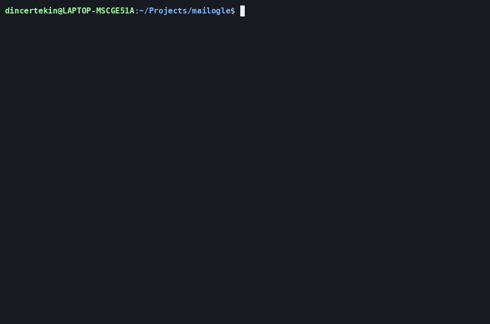

# mailogle

<p>
  <picture><source media="(prefers-color-scheme: dark)" srcset="https://raw.githubusercontent.com/dincertekin/dincertekin/main/assets/badges/python-313-dark.svg"></picture>
  <a href="LICENSE"><picture><source media="(prefers-color-scheme: dark)" srcset="https://raw.githubusercontent.com/dincertekin/dincertekin/main/assets/badges/mit-dark.svg"></picture></a>
</p>

**Find out where an email address has an account.** Give mailogle an email
and it checks 13 sites in parallel, telling you which ones it's registered
on, without logging in. It also checks HudsonRock's database of infostealer
leaks.



> For OSINT research, security assessments and checking your own footprint.
> Only scan addresses you're authorized to investigate.

## What it checks

| | | |
|---|---|---|
| Amazon | Apple TV | Facebook |
| GitHub | Gravatar | Instagram |
| MyFitnessPal | Netflix | Pinterest |
| Snapchat | Spotify | WordPress |
| X | HudsonRock (infostealer leaks) | |

Each site reports **Found**, **Not found** or **Error**, with extra detail
when the site gives some away.

## Install

Requires Python 3.13+.

```bash
git clone https://github.com/dincertekin/mailogle.git
cd mailogle
pip install -r requirements.txt     # or: poetry install
```

## Usage

```bash
python mailogle.py someone@example.com              # check every site
python mailogle.py -m github someone@example.com    # check one site
python mailogle.py -o csv someone@example.com       # also save results to a file
python mailogle.py -l                               # list the sites
```

| Option | What it does |
|---|---|
| `-m`, `--module <name>` | Check only one site (names from `-l`) |
| `-o`, `--output json\|csv` | Save results to `<email>_results.json` or `.csv` |
| `-l`, `--list-modules` | List available sites and exit |

## Adding a site

Each site is one small file in [`modules/`](modules). Copy
[`modules/_template.py`](modules/_template.py) to a new name (without the
leading underscore), fill in the check, and it's picked up automatically.
Tests live in [`tests/`](tests):

```bash
pip install -r requirements-dev.txt
pytest
```

New modules and fixes for sites that changed are very welcome. Open an issue
or a pull request.

Inspired by [holehe](https://github.com/megadose/holehe).

## License

[MIT](LICENSE)
